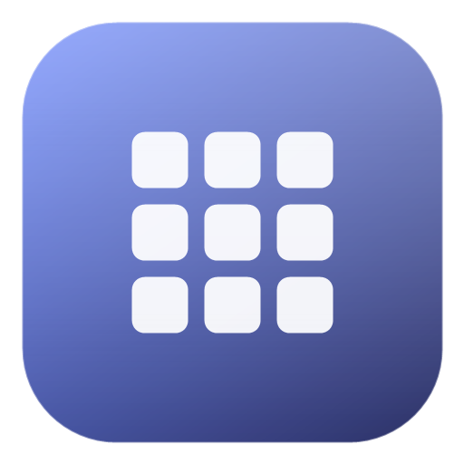

<div align="center">



<h1>iOS Folder Widget</h1>

<p><strong>把 Windows 桌面文件夹，变成 iPhone 主屏文件夹。</strong></p>

<p>真实目录 · 磨砂玻璃 · 点击展开 · 多组件 · 拖放操作</p>

<a href="https://github.com/kesai666/Desktop-folder/releases/latest">
  
</a>


</div>

---

## 它是什么

iPhone 的文件夹是桌面上的一个小方块：先让你看到里面有什么，点开才展开。

**iOS Folder Widget 把这个体验搬到 Windows。**

桌面上看到的是圆角、磨砂、带网格预览的 iPhone 文件夹；点开之后，里面是你的真实文件：双击打开、右键菜单、拖入拖出、搜索排序，全都直接作用在磁盘目录上。

> 不是快捷方式套壳，也不是虚拟目录。每个小组件背后，都是一个真实文件夹。

## 为什么用它

- **一眼看到内容**：收起时是 2×2 / 3×3 / 4×4 网格预览，不用先打开资源管理器。
- **点开就能操作**：双击文件用默认程序打开，双击文件夹进入下一级，右键就是原生菜单。
- **桌面上完成整理**：拖文件进来、拖图标出去、框选多选、批量删除，像整理手机主屏一样整理桌面。
- **一个组件一个目录**：工作资料、下载、素材、相册可以各放一个组件，互不干扰。
- **看起来是 iPhone，背后是 Windows**：不接管资源管理器，不改变你的目录结构，不移动已有文件。

## 功能

### 外观

- 自绘磨砂玻璃：圆角、模糊、霜白叠层，会随当前壁纸取景。
- 三种预览密度：**2×2（整体更小）/ 3×3（标准）/ 4×4（整体更大）**，文件夹本身会跟着变大小，不只是图标变疏密。
- 每个组件可单独设置壁纸：预览、选择、清除、模糊开关、缩放、裁剪方式、裁剪位置。
- 可调玻璃模糊、霜白强度、图标大小。
- 收起是文件夹，点开原位展开成面板；面板会避开屏幕边缘。

### 文件

- 真实目录：打开、进入子文件夹、重命名、删除、新建文件夹、新建快捷方式。
- 搜索当前文件夹，按名称 / 修改时间 / 大小 / 类型排序。
- Ctrl / Shift 多选，空白处拖框选。
- 拖文件进来：询问「移动到这里 / 创建快捷方式 / 取消」。
- 拖图标出去：桌面或资源管理器里落地为移动，其它应用按复制处理。
- 删除进应用回收站，`Ctrl+Z` 撤销，默认保留 7 天。
- 快捷方式图标会解析目标程序，去掉左下角小箭头；「此电脑」「回收站」这类系统位置也能取到正确图标。

### 桌面

- 多个小组件可以同时摆放，各自绑定不同目录。
- 拖动时靠近其它组件会自动吸附，留出固定间距，不会叠在一起。
- 新建组件优先放在已有组件右侧或下方；没有空位会自动找位置。
- 组件不进任务栏；托盘菜单集中管理所有文件夹、开机启动和设置。
- 位置、尺寸、排序、壁纸、外观都会保存，重启后恢复。

### 系统

- 开机自启动可开关，默认不强制写入。
- 配置原子写入并保留备份，异常退出不容易写坏。
- 拖出移动会对目标文件做 SHA-256 校验，确认一致才移除源文件。
- 检查更新：读取 GitHub Releases 最新版，有新版本时打开下载页。

## 安装

### 下载

前往 **[Releases](https://github.com/kesai666/Desktop-folder/releases/latest)**，下载最新版：

```text
iOS.Folder.Widget.Setup.<版本>.exe
```

双击安装，按提示选择是否为当前用户安装、是否创建桌面 / 开始菜单快捷方式。

### 系统要求

- Windows 10 / 11 x64
- 不需要 Node.js，不需要源码目录

> 如果 Windows 首次运行提示「未知发布者」，点「更多信息 → 仍要运行」即可。

## 快速上手

1. 安装并启动，桌面上会出现一个文件夹组件（默认绑定桌面；右键可以换目录）。
2. **单击**组件展开，**双击**文件打开，**双击文件夹**进入下一级。
3. 右键组件 → **「壁纸与外观…」**，可以换壁纸、调模糊、切 2×2 / 3×3 / 4×4。
4. 托盘图标 → **「新建文件夹小组件…」**，添加更多文件夹组件。
5. 把文件从资源管理器拖进面板，或把面板里的图标拖到桌面。

## 快捷键

| 操作 | 功能 |
|---|---|
| 单击组件 | 展开面板 |
| `Esc` / 点窗口外 / `×` | 收起 |
| 双击 | 打开文件 / 进入文件夹 |
| `Backspace` / 左上 `‹` | 返回上一级 |
| 方向键 / `Enter` | 选择 / 打开 |
| `F2` | 重命名 |
| `Delete` | 删除到应用回收站 |
| `Ctrl+Z` | 撤销上一次删除 |
| `Ctrl` / `Shift` + 单击 | 多选 |
| 空白处拖动 | 框选 |
| `Ctrl+C` / `Ctrl+X` / `Ctrl+V` | 应用内复制 / 剪切 / 粘贴 |
| `Ctrl+F` | 搜索当前文件夹 |
| `Ctrl+Shift+N` | 新建文件夹 |

## 自定义

右键组件 → **「壁纸与外观…」**：

- **壁纸**：选择图片后实时预览；支持模糊、缩放、`cover` / `contain`、裁剪位置。
- **预览网格**：2×2、3×3、4×4，整个文件夹会一起缩放。
- **玻璃**：模糊强度、霜白强度、图标大小。
- **行为**：开机自启动、检查更新、应用回收站、日志目录。

配置文件位于：

```text
%APPDATA%\ios-folder-widget\config.json
```

卸载不会删除这个目录，重装后配置还在。

## 文件安全

- 所有文件操作都在本机完成，不上传文件，不需要账号。
- 拖出「移动」不是猜的：目标文件通过 SHA-256 内容校验后才移除源文件。
- 删除先进应用回收站，不直接永久删除。
- `config.json` 使用临时文件 + rename 原子写入，并保留 `.bak` 备份。
- 除「检查更新」外，应用不主动联网。

## 从源码运行

需要 Node.js 20+、pnpm。

```bash
pnpm install
pnpm start
```

打包 Windows 安装包：

```bash
pnpm run dist
```

产物在 `dist/`。

测试：

```bash
pnpm test
pnpm test:e2e
```

<details>
<summary>项目结构</summary>

```text
src/main.js              主进程：窗口、托盘、菜单、文件 IPC、拖放、尺寸与位置
src/preload.js           安全桥（contextBridge）
src/fsutil.js            目录列举、重命名、移动、SHA-256 校验
src/renderer/            桌面小组件界面（HTML / CSS / JS）
src/settings.html|js     独立设置窗口
scripts/extract-icon.ps1 .lnk / 系统位置图标提取
scripts/resolve-drop.ps1 拖放落点解析
scripts/after-pack.js    打包后写 exe 图标与版本信息
test/                    文件层单测 + Electron 冒烟测试
.github/workflows/       Windows 构建与 Release
```

</details>

## 反馈

- **Bug / 功能建议**：优先提 [Issue](https://github.com/kesai666/Desktop-folder/issues)。Bug 请附应用版本、Windows 版本和复现步骤；日志在 `%APPDATA%\ios-folder-widget\logs\main.log`。
- **安全漏洞**：不要公开提交 Issue，请使用 [GitHub 私密漏洞报告](https://github.com/kesai666/Desktop-folder/security/advisories/new)。
- 不公开邮箱和社交账号；所有反馈尽量留在 Issue 里，方便追踪和搜索。

## License

[MIT](LICENSE) © 2025-2026 ios-folder-widget contributors

<div align="center">

[](https://github.com/kesai666/Desktop-folder/actions/workflows/build.yml)

</div>
